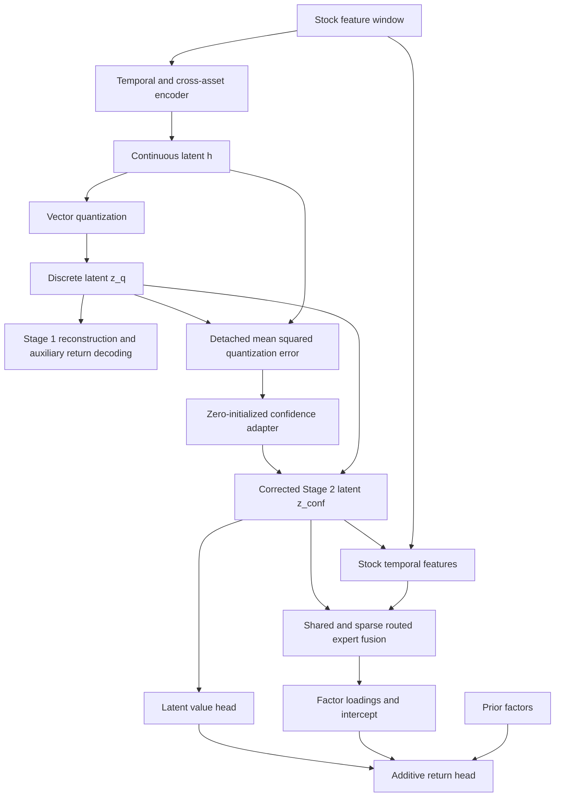

# TRACE-VQ: mechanisms and implementation

The package follows the model's computational structure, rather than the
experiment numbers or inherited `module/layers/src` layout. Configuration keys,
checkpoint parameter paths, loss formulas and default hyperparameters remain
compatible with the migrated 034 implementation.

## Mechanism map

| Mechanism | Implementation | Responsibility |
| --- | --- | --- |
| Temporal representation | `trace_vq/models/temporal/encoder.py` | Feature transform, projection, positional encoding, temporal attention/aggregation, then cross-asset attention |
| w/o TA representation | `trace_vq/models/temporal/gru.py` | Original experiment 025 feature transform and GRU, then the same cross-asset Transformer |
| Discrete latent factors | `trace_vq/models/quantization/codebook.py` | Single vector codebook; default 512 entries of dimension 128 |
| Quantization confidence | `trace_vq/models/confidence/adapter.py` | Detached quantization distortion and zero-initialized latent correction |
| Shared and routed experts | `trace_vq/models/experts/shared_routed.py`, `fusion.py` | Always-on shared expert plus sparse routing; shared expert does not consume the top-k quota |
| Factor return prediction | `trace_vq/models/prediction/` | DLinear/temporal loading generator, latent values, and additive prior/latent return heads |

`models/representation.py` composes the Stage 1 VQ autoencoder. Reconstruction
and auxiliary future-return decoding remain in `models/temporal/decoders.py`;
the GRU there is an auxiliary decoder, not the temporal-attention encoder.
Generic normalization, decomposition and position layers live in
`models/components/`. Inherited RWKV/attention/router alternatives are isolated
under `components/legacy/` and are not imported by the active model path.

## Computational flow



Stage 1 learns the encoder/codebook through reconstruction, VQ and auxiliary
prediction losses. Stage 2 freezes the encoder, quantizer and RevIN in eval
mode. Its correction is:

```text
q_error = mean((detach(h) - detach(z_q))², dim=-1, keepdim=True)
z_conf  = detach(z_q) + QuantizationConfidenceAdapter(q_error)
```

`models/temporal/__init__.py` selects the encoder from `vqvae.encoder.type`:
`temporal-attention` is the full-model default; `gru` restores experiment 025's
`temporal_extractor.*` checkpoint paths and construction order. Both Stage 1
and Stage 2 use this selection. The existing switches
`predictor.quantization_confidence_adapter=false` and
`predictor.shared_expert=false` implement experiments 037 and 038 respectively;
disabled modules contribute no parameters or state-dict entries. In w/o SR,
the original sparse routed experts and top-k behavior remain active.

The four Hydra experiment groups preserve historical model/training settings
and select the correct imported Stage 1 checkpoint. They reuse HVQ-Stock data
and isolate new training outputs. The archived evaluation configurations beside
each Stage 2 checkpoint also preserve its seed and effective settings. See
`experiments.md` for commands and provenance.

The adapter subclasses `nn.Linear` directly and retains flat `weight`/`bias`
keys. It is instantiated at the same point as before, consumes the same random
initialization, then zeros its parameters. Thus both the initial zero
correction and the initialization of all other parameters are preserved.
The shared expert likewise remains a zero-initialized residual path; routing,
auxiliary losses and top-k semantics are unchanged.

## Training, data and evaluation

- `training/representation.py`: Stage 1 Lightning module (`FactorVQVAE`).
- `training/prediction.py`: Stage 2 Lightning module (`GenerateReturn`),
  checkpoint loading, frozen-module lifecycle, optimizer and training steps.
  Its stable module attribute names intentionally preserve checkpoint keys.
- `cli/`: Hydra applications and standalone checkpoint evaluation. Root-level
  scripts are compatibility wrappers for the same applications.
- `data/`: canonical `[N,20,244]` schema, samplers, feature generation and
  batching. Data-generation YAML resides in `configs/data/`; actual raw and
  processed datasets stay outside the package under ignored `dataset/` paths.
- `evaluation/`: inference, IC/RankIC metrics, portfolio backtesting and score
  ensembling. `losses/` contains the ranking objectives used during training.

The classes retain their established names for compatibility. New work should
import the canonical modules, for example:

```python
from trace_vq.models.confidence.adapter import QuantizationConfidenceAdapter
from trace_vq.models.experts.shared_routed import FactorGatedMoE
from trace_vq.training.prediction import GenerateReturn
```

## Compatibility and audit

Old `module`, `trainer`, `dataset`, and `utils` imports are forwarding shims,
not duplicate implementations. Old pickle references such as
`dataset.market.CanonicalSampler` remain resolvable. Model state-dict keys and
existing CLI flags remain unchanged. Dataset YAML paths have moved to
`configs/data/{csi300,sp500}.yaml`; custom commands that explicitly name the old
YAML paths must use the new paths.

`docs/restructure_map.json` maps the migration snapshot to the current files.
The original migration manifest is archived under `docs/migration/` and its
hashes apply specifically to commit `f4d962c`, not to relocated files.

Verification includes all behavioral tests, old import/pickle compatibility,
strict loading of pre-refactor state dictionaries, and direct comparison of
both stages before/after restructuring. Fixed-seed initial tensors and forward
outputs are bitwise identical. Synthetic one-epoch training and standalone
evaluation exercise the preserved CLI entrypoints. The original structural
verification did not include historical real-data metrics. The subsequent
experiment import and consistency audit is recorded in
`migration/consistency_report.json`. It compares frozen source code on CPU
and GPU, requires exact source/migrated scores over the complete GPU test set,
and reports cross-hardware differences against archived predictions separately.
