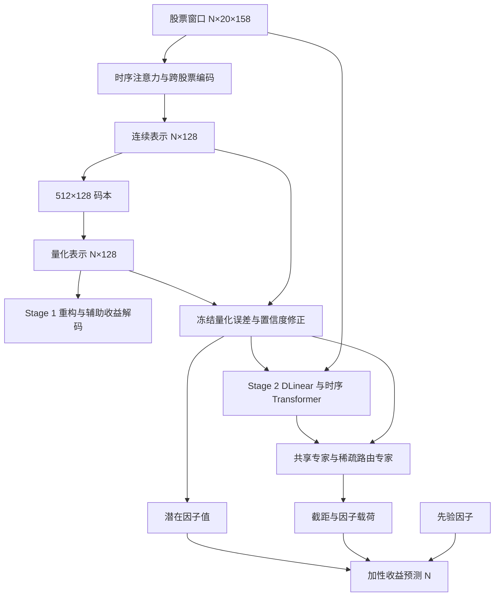

# TRACE-VQ 架构与代码导读

TRACE-VQ 先学习离散的股票表示，再用冻结表示辅助收益预测。研究入口在
`trace_vq/`；根目录脚本和旧目录主要承担导入兼容。

本目录属于独立的 `TRACE-VQ-research` 仓库。原项目 `../TRACE-VQ` 保留原分支、
未提交修改、数据和实验文件。旧研究基线标签 `research-baseline-20261026` 保存了
复制时的工作代码，包括 CSI800 修改；旧 Git 元数据现仅保留在本地忽略的
`artifacts/research/history_reset_*/` 备份内，当前 Git 从新的 `main` 初始提交开始。
数据、检查点、Git 对象均为独立文件。
绝对日志软链接已转向研究副本。原目录状态、逐文件 SHA-256 与原始 diff 保存在
`research/baseline/`（本地保留，不纳入后续 Git 同步）。

## 从一次运行开始

在研究副本根目录运行：

```bash
cd TRACE-VQ-research
./research/run.sh research/walkthrough.py
```

演示使用默认模型尺寸和 8 只股票的合成截面，完成两阶段的前向与反向传播，
输出关键模块的张量形状、损失项、参数量和冻结状态。Stage 2 从演示临时生成的
Stage 1 权重加载；没有使用历史训练权重，也没有执行优化器更新。
报告保存在 `artifacts/research/walkthrough/<时间>/report.json`。

启动脚本复用现有 `prism-vq` Python，不安装或修改依赖。它设置本进程的导入路径、
本地缓存和离线日志；它不是操作系统级的写入隔离。新实验仍应指定本副本下的输出目录。

## 数据与计算主线

一个 batch 是同一交易日的股票截面。`N` 是当日股票数，随日期变化，
不是固定由 `train.batch_size=300` 决定。实际分批由
[DailyBatchSamplerRandom](../trace_vq/data/loaders.py) 控制。

[schema.py](../trace_vq/data/schema.py) 将 `[N,20,244]` 拆分为：

| 内容 | 模型得到的形状 | 用途 |
| --- | --- | --- |
| 股票特征 | `[N,20,158]` | 两阶段的主要输入 |
| 先验因子 | `[N,13]` | 取窗口最后时刻，参与重构和收益预测 |
| 市场特征 | `[N,20,63]` | 原基线未使用；市场条件研究变体显式使用 |
| 未来收益标签 | `[N,10]` | Stage 1 辅助目标；Stage 2 默认取第 5 列 |

Stage 1 的时序注意力先在每只股票的 20 日窗口内聚合，再通过跨股票 Transformer
处理同日股票间的关系。编码结果 `[N,128]` 在一个 `[512,128]` 码本里查找离散向量。
512 是可选码字数，128 是每个码字的维度。量化器还返回每只股票的码字索引 `[N]`。



Stage 2 的时序 Transformer 也会接收修正后的表示；它与 Stage 1 的编码器是两套模块。
Stage 1 的重构解码器和辅助收益解码器不参与 Stage 2 的预测。

## 建议阅读顺序

| 顺序 | 文件 | 阅读时要弄清的问题 |
| --- | --- | --- |
| 1 | [配置](../configs/config.yaml)、[数据 schema](../trace_vq/data/schema.py)、[loader](../trace_vq/data/loaders.py) | 输入列的含义是什么？为什么必须按同日股票分批？ |
| 2 | [Stage 1 组合模型](../trace_vq/models/representation.py) | `VQVAE.forward` 如何串起编码、量化、重构和辅助预测？ |
| 3 | [时序与跨股票编码](../trace_vq/models/temporal/encoder.py) | 时间轴在哪里聚合？股票轴在哪里发生注意力？ |
| 4 | [向量量化](../trace_vq/models/quantization/codebook.py) | 最近码字、直通梯度、码字使用率和训练期更新分别做什么？ |
| 5 | [Stage 2 主模型](../trace_vq/training/prediction.py) | `GenerateReturn` 如何加载 Stage 1，并在 `train()` 中保持冻结模块处于 eval？ |
| 6 | [置信度适配器](../trace_vq/models/confidence/adapter.py) | 一个标量量化误差如何变成 128 维修正？梯度在哪里被截断？ |
| 7 | [载荷生成](../trace_vq/models/prediction/loadings.py)、[融合](../trace_vq/models/experts/fusion.py)、[MoE](../trace_vq/models/experts/shared_routed.py) | 股票时序特征如何进入专家？潜在表示如何控制路由和 FiLM 载荷？ |
| 8 | [收益头](../trace_vq/models/prediction/heads.py)、[训练入口](../trace_vq/cli/stage2.py)、[评估入口](../trace_vq/cli/evaluate.py) | 最终收益如何计算？实际配置、最佳验证检查点和预测文件怎样连接？ |

## 两个阶段分别学习什么

Stage 1 由 [FactorVQVAE](../trace_vq/training/representation.py) 组织训练：

```text
L1 = 特征重构 MSE + VQ loss + 0.0001 × 辅助未来收益 MSE
```

VQ loss 含 commitment 和 codebook 两项；默认训练时还加入对比损失。
默认 `anchor=probrandom` 会在训练前向中按码字使用率调整码本。
验证模式不执行这些训练期分支，所以阅读验证损失时要结合量化器的 `self.training` 判断。

Stage 2 冻结 Stage 1 的 encoder、quantizer 和 RevIN。冻结不只意味着
`requires_grad=False`：还必须保持它们处于 eval，避免 dropout 和量化器训练期更新。
置信度修正是：

```text
q_error = mean((detach(h) - detach(z_q))²)     # [N,1]
z_conf  = detach(z_q) + Linear(q_error)       # [N,128]
```

这个 Linear 的权重和偏置都从零开始，所以初始修正为零。修正后的表示同时进入
Stage 2 时序模块、专家融合和潜在因子值预测头。CSI300/CSI800 默认有 2 个路由专家，
每个样本选 top-1；另有一个始终激活的共享专家，不占用 top-k 名额。

最终预测是 `alpha + sum(beta_prior × prior) + sum(beta_latent × latent_value)`，
默认潜在因子项的宽度是 128。训练目标为：

```text
L2 = RankLoss(prediction, label) + 0.01 × softcap(auxiliary_loss)
```

默认 `predictor.rank=0`，此时 `RankLoss` 实际只剩 MSE。
这里的辅助损失包含 MoE 的负载/重要性均衡项和载荷范数项，随后统一执行 softcap。

## 容易读错的细节

- YAML 中 `vqvae.quantizer.decay=0.95`，当前 `VectorQuantiser` 内部实际固定为
  `0.99`，构造路径没有传入 YAML 的这个值。演示报告会同时列出两者；研究副本保留现有行为。
- 默认标签经过数据处理器处理，不能直接把网络输出当成原始收益率。
  标签生成见 [prepare.py](../trace_vq/data/prepare.py)，学习期标签处理见
  [CSI300 数据配置](../configs/data/csi300.yaml)。
- 默认新训练两阶段都使用 `train.seed=0`；导入的历史 Stage 1 权重使用 seed 42。
  做结构对照时应明确复用历史 Stage 1，还是重新训练两阶段。
- `wo_ta` 把 Stage 1 时序编码改回 GRU，仍保留跨股票注意力；`wo_ca` 移除置信度适配器；
  `wo_sr` 移除共享专家，仍保留稀疏路由专家。配置在 [experiment/](../configs/experiment/)。

## 在副本中继续研究

CSI800 数据来自完整副本；CSI300 三个 split 从原有 HVQ-Stock 另行复制，均已逐文件校验。
启动脚本将训练数据默认指向本副本。SP500 数据未额外复制。

```bash
# 现有合成测试和集成测试
./research/run.sh -m unittest discover -s tests -v

# 检查原项目状态；--full 包含全部大文件的 SHA-256
./research/run.sh research/verify_baseline.py --full

# 后续需要复算历史预测时，显式指定本副本的数据和新输出位置
./research/run.sh -m trace_vq.cli.evaluate --experiment full --seed 0 \
  --data-path dataset/processed --output-dir artifacts/research/full_seed0_eval
```

需要训练时，为每次运行设置独立的 `artifact_root=artifacts/research/<run_name>`。
原始结果与已有研究输出都可以保留作对照。更完整的机制说明见
[architecture.md](../docs/architecture.md)，历史实验对应关系见
[experiments.md](../docs/experiments.md)。

本次准备已通过 112 项现有测试、合成数据的两阶段演示，以及原目录 2,135 个
普通文件的全量 SHA-256 校验。检查结果与演示报告位置记录在
`research/validation.json`（仅本地保留）；原目录的文件和 Git 状态均未变化。
